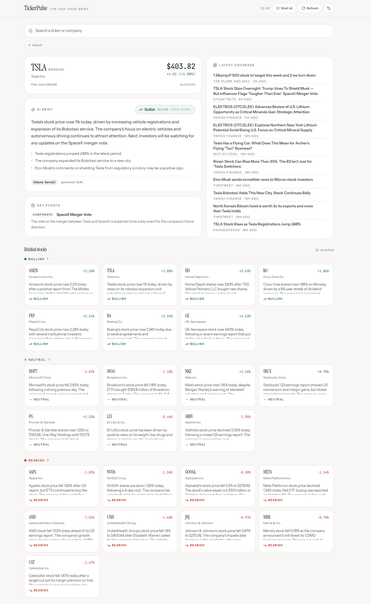

# news-ticker

A news ticker application




## Getting Started

### Prerequisites

Before you can run the application, you need to install the prerequisite dependencies. You can do this by running the following command:
```
curl -fsSL https://ollama.com/install.sh | sh;
ollama pull qwen3:latest;
ollama pull qwen3:0.6b;

```
This command will install the necessary dependencies, including Node.js and npm.

### Installation

1. Clone the repository: `git clone git@github.com:santenova/ticker.git`
2. Install dependencies: `npm install`
3. Build the application: `npm run build`
4. Test the application: `npm test`
4. Start the application: `npm run dev`

### Scripts

* `dev`: Start the application in development mode
* `build`: Build the application for production
* `lint`: Run ESLint on the code
* `lint:fix`: Fix ESLint errors
* `typecheck`: Run TypeScript type checking
* `preview`: Preview the application

### Dependencies

* `React`: ^18.2.0
* `React-dom`: ^18.2.0
* `Vite`: ^8.2.0
* `news-api`: ^1.0.0 (for fetching news articles)
* `stock-api`: ^2.0.0 (for fetching stock data)
* `rss2json`: ^1.1.0 (for parsing RSS feeds)


### Components

* `TickerSearch`: A search component for finding news articles
* `WatchlistChips`: A component for displaying watchlist chips
* `SettingsPanel`: A settings panel for configuring the application
* `BriefAllPanel`: A panel for displaying all briefing results
* `BriefedStocks`: A component for displaying briefed stock information

### APIs

* `fetchBriefing`: Fetches briefing data for a given symbol
* `fetchProfile`: Fetches profile data for the user
* `mutateWatchlist`: Mutates the watchlist for the user

### Functions

* `clockOf`: Converts an ISO date to a human-readable time string
* `load`: Loads briefing data for a given symbol
* `toggleWatch`: Toggles a stock's watch status

### States

* `symbol`: The current symbol being displayed
* `watchlist`: The user's watchlist
* `settings`: The user's settings
* `briefing`: The briefing data for the current symbol
* `loading`: Whether the application is loading data
* `error`: Any error messages
* `settingsOpen`: Whether the settings panel is open
* `allOpen`: Whether the all panel is open
* `allResults`: The all results for the current symbol
* `allRunning`: Whether the all panel is running
* `allAbort`: The abort controller for the all panel

### News Feed Providers

* `Yahoo Finance`: Fetches news articles from Yahoo Finance
* `Google News`: Fetches news articles from Google News
* `CNBC`: Fetches news articles from CNBC
* `TheStreet`: Fetches news articles from TheStreet
* `Reuters`: Fetches news articles from Reuters
* `Bloomberg`: Fetches news articles from Bloomberg
* `Financial Times`: Fetches news articles from Financial Times
* `WSJ`: Fetches news articles from WSJ
* `Barron’s`: Fetches news articles from Barron’s
* `IBD`: Fetches news articles from IBD
* `Benzinga`: Fetches news articles from Benzinga
* `MarketWatch`: Fetches news articles from MarketWatch
* `Investopedia`: Fetches news articles from Investopedia
* `Seeking Alpha`: Fetches news articles from Seeking Alpha
* `Stocktwits`: Fetches news articles from Stocktwits
* `Business Insider`: Fetches news articles from Business Insider
* `New York Times`: Fetches news articles from New York Times
* `AP News`: Fetches news articles from AP News

### Data Source References

* `news-api`: Fetches news articles from various sources
* `stock-api`: Fetches stock data from various sources
* `rss2json`: Parses RSS feeds from various sources


### Prompts

#### system prompt

```
You are the night-desk editor of a markets briefing app.
You read the newest headlines about one stock and write a brief a trader can scan in fifteen seconds. Plain declarative prose,
no hype, no advice, no price targets.
```
#### summarize prompt

```
Stock: ${name || symbol} (${symbol})
${priceLine}
Time now: ${new Date().toISOString()}

Newest headlines, newest first:
${headlineLines}

Write the brief. Return JSON only with this shape:
{"summary": string, "sentiment": "bullish" | "bearish" | "neutral", "sentimentScore": number, "confidence": "low" | "medium" | "high", "bullets": string[], "keyEvents": [{"type": string, "title": string, "detail": string}]}

Rules:
- summary: 2 to 4 sentences of plain prose. Say what moved the stock or the story, and what matters next. No recommendations, no price predictions, no hedging filler.
- sentiment: the tone of this news flow for the next few sessions. sentimentScore: 0 is deeply bearish, 50 is mixed, 100 is deeply bullish.
- bullets: 2 to 4 factual takeaways, max 18 words each.
- keyEvents: only material items (earnings, guidance, analyst actions, products, regulatory, M&A, executive changes). type is one of earnings, analyst, product, regulatory, corporate, macro. Skip routine price commentary. Use an empty array if nothing material.
- Use only the headlines above. Never invent facts, numbers, or headlines.;


    
```

### Chat Conversation OpenAI-api style messages array

```


[
  {
    "id": "chatcmpl-521",
    "object": "chat.completion",
    "created": 1793705800,
    "model": "llama3.1",
    "system_fingerprint": "fp_ollama",
    "choices": [
      {
        "index": 0,
        "message": {
          "role": "assistant",
          "content": "{\n  \"summary\": \"Tesla's stock price rose 1% today, driven by news of its expanding robotaxi service and increased vehicle registrations. Analysts have raised their fair value estimates for Tesla and SpaceX, but warn that the company needs better marketing to maintain its market share. The potential for a SpaceX-Tesla merger remains a key topic of discussion.\",\n  \"sentiment\": \"bullish\",\n  \"sentimentScore\": 80,\n  \"confidence\": \"high\",\n  \"bullets\": [\n    \"Tesla's robotaxi service now available in a new city.\",\n    \"Vehicle registrations jump 248%.\",\n    \"Analysts raise fair value estimates for Tesla and SpaceX.\"\n  ],\n  \"keyEvents\": [\n    {\n      \"type\": \"product\",\n      \"title\": \"Tesla Robotaxi Expansion\",\n      \"detail\": \"Tesla's robotaxi service now available in a new city.\"\n    },\n    {\n      \"type\": \"analyst\",\n      \"title\": \"Analyst Estimates Raised\",\n      \"detail\": \"Analysts raise fair value estimates for Tesla and SpaceX.\"\n    },\n    {\n      \"type\": \"corporate\",\n      \"title\": \"Potential SpaceX-Tesla Merger\",\n      \"detail\": \"Analysts discuss potential market reaction to a SpaceX-Tesla merger.\"\n    }\n  ]\n}"
        },
        "finish_reason": "stop"
      }
    ],
    "usage": {
      "prompt_tokens": 798,
      "completion_tokens": 276,
      "total_tokens": 1074
    }
  },
  {
    "model": "llama3.1",
    "temperature": 0.2,
    "stream": false,
    "messages": [
      {
        "role": "system",
        "content": "You are the night-desk editor of a markets briefing app. You read the newest headlines about one stock and write a brief a trader can scan in fifteen seconds. Plain declarative prose, no hype, no advice, no price targets."
      },
      {
        "role": "user",
        "content": "Stock: Tesla Inc (TSLA)\nLast price $403.82 (+1% today, previous close 403.82)\nTime now: 2026-11-03T11:36:34.121Z\n\nNewest headlines, newest first:\n1. [The Globe and Mail] 1 S&amp;P 500 stock to target this week and 2 we turn down (2026-11-03T10:07:30.000Z)\n2. [Yahoo Finance] TSLA Stock Slips Overnight: Trump Vows To Shield Musk — But Influencer Flags ‘Tougher Than Ever’ SpaceX Merger Vote (2026-11-03T08:15:08.000Z)\n3. [Investor's Business Daily] Tesla Robotaxi Adds This New City, Stock Continues Rally (2026-11-02T21:00:00.000Z)\n4. [FinanceFeeds] TSLA Stock Rises as Tesla Registrations Jump 248% (2026-11-02T19:28:25.000Z)\n5. [Benzinga] Tesla Stock Moves Higher: What's Going On? - Tesla (NASDAQ:TSLA) (2026-11-02T19:11:56.000Z)\n6. [TipRanks] Fans Release Tesla Roadster-Themed Browser Game, Tesla Stock (NASDAQ:TSLA) Gains (2026-11-02T17:35:38.000Z)\n7. [Investing.com] Analyst models potential market reaction to a SpaceX-Tesla all-stock merger (2026-11-02T15:45:05.000Z)\n8. [Morningstar] We Raised Our Fair Value Estimates for Tesla and SpaceX. Are They Buys? (2026-11-02T10:06:45.000Z)\n9. [Yahoo Finance] Gary Black Says Tesla Is Losing EV Share to ‘No-Name’ Rivals Despite ‘Huge First-Mover Advantage’—Warns TSLA Needs Better Marketing (2026-11-02T05:35:00.000Z)\n10. [Yahoo Finance] Cybercab Expansion Might Change The Case For Investing In Tesla Stock (TSLA) (2026-11-01T05:16:00.000Z)\n\nWrite the brief. Return JSON only with this shape:\n{\"summary\": string, \"sentiment\": \"bullish\" | \"bearish\" | \"neutral\", \"sentimentScore\": number, \"confidence\": \"low\" | \"medium\" | \"high\", \"bullets\": string[], \"keyEvents\": [{\"type\": string, \"title\": string, \"detail\": string}]}\n\nRules:\n- summary: 2 to 4 sentences of plain prose. Say what moved the stock or the story, and what matters next. No recommendations, no price predictions, no hedging filler.\n- sentiment: the tone of this news flow for the next few sessions. sentimentScore: 0 is deeply bearish, 50 is mixed, 100 is deeply bullish.\n- bullets: 2 to 4 factual takeaways, max 18 words each.\n- keyEvents: only material items (earnings, guidance, analyst actions, products, regulatory, M&A, executive changes). type is one of earnings, analyst, product, regulatory, corporate, macro. Skip routine price commentary. Use an empty array if nothing material.\n- Use only the headlines above. Never invent facts, numbers, or headlines."
      }
    ]
  }
]

```


### npm test


```
> news-ticker@0.0.0 test
> node --experimental-vm-modules node_modules/jest/bin/jest.js --runInBand

(node:1159496) ExperimentalWarning: VM Modules is an experimental feature and might change at any time
(Use `node --trace-warnings ...` to show where the warning was created)
 PASS   logic  tests/aiBackends.test.js
 PASS   ui  tests/jsx.test.jsx
 PASS   logic  tests/briefingPrompt.test.js

Test Suites: 1 skipped, 3 passed, 3 of 4 total
Tests:       2 skipped, 11 passed, 13 total
Snapshots:   0 total
Time:        2.379 s
Ran all test suites in 2 projects.


```
